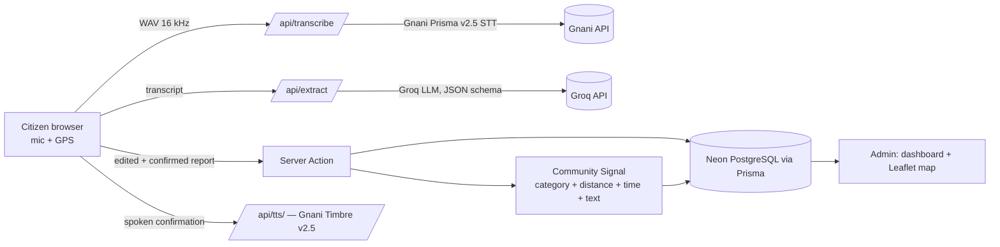

# AwaazMap — Every Voice. A Better City.

Voice-powered civic intelligence: citizens speak a complaint, AI structures it, and **Community Signal** groups related
reports into community-level incidents shown on a live map and an analytics dashboard.

## Architecture


## Stack
Next.js 15 (App Router) · TypeScript · Tailwind CSS 3 · Prisma 6 · Neon PostgreSQL · Leaflet/react-leaflet ·
Gnani (Prisma v2.5 STT, Timbre v2.5 TTS) · Groq (structured extraction) · map tiles from a keyed provider (OpenStreetMap data).

## Setup
```bash
npm install
cp .env.example .env            # fill in every value
npx prisma migrate dev          # creates/updates tables
npm run db:seed-demo            # optional: simulated, clearly labelled demo data
npm run dev                     # http://localhost:3000
npm run check                   # offline logic checks (no network)
```
Routes: `/` · `/report` · `/report/[id]` · `/admin` · `/admin/complaints` · `/admin/incidents` · `/admin/map` · `/api/health`


## Environment variables (server-side unless prefixed NEXT_PUBLIC_)
`DATABASE_URL` `DIRECT_URL` `GNANI_API_KEY` `GROQ_API_KEY` `GROQ_MODEL` (optional) `HEALTH_TOKEN` (optional)
`NEXT_PUBLIC_TILE_URL` `NEXT_PUBLIC_TILE_ATTRIBUTION` (public by design: a restricted map key)
